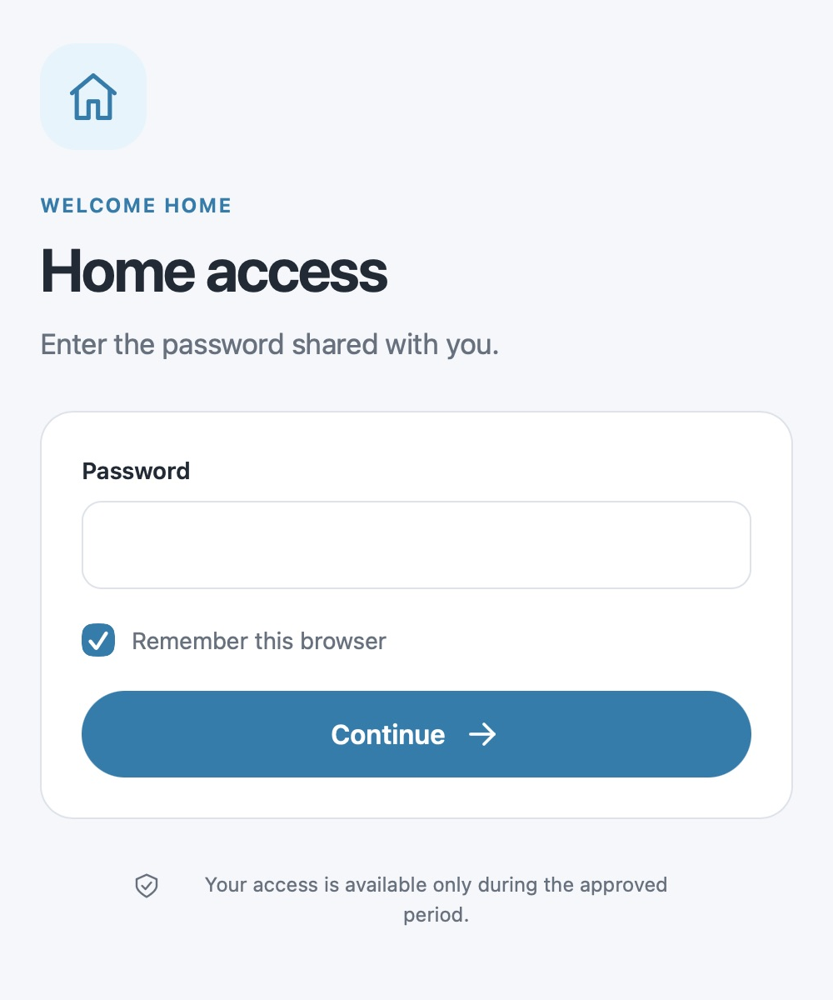
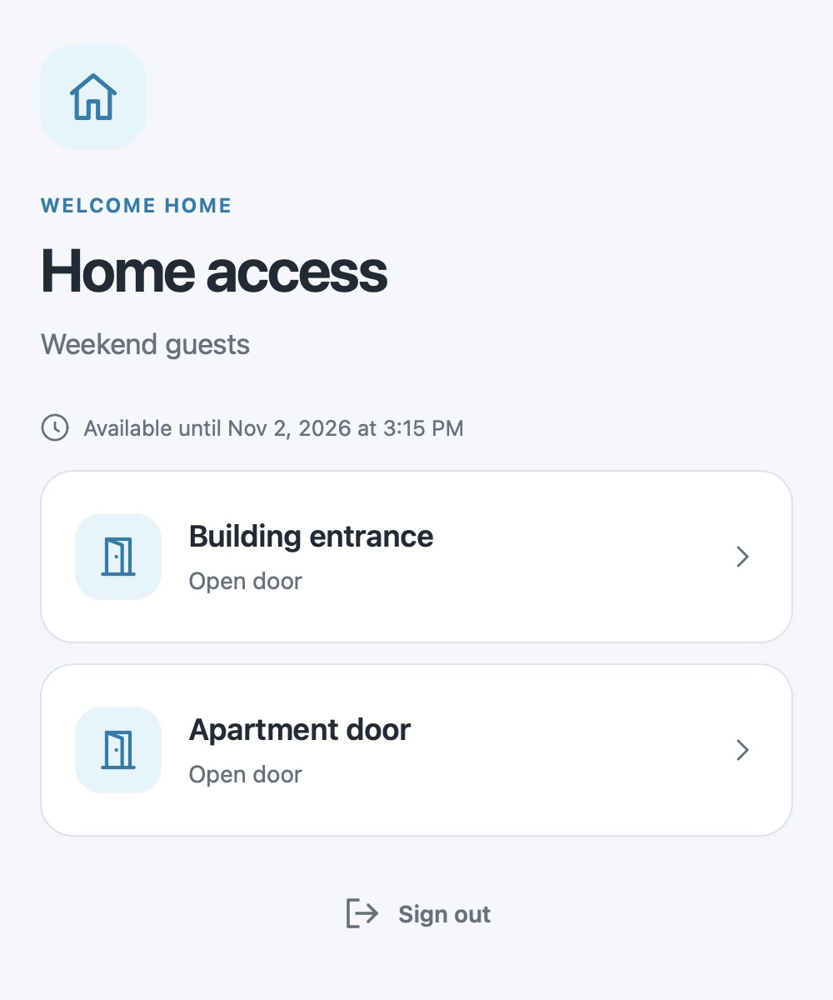
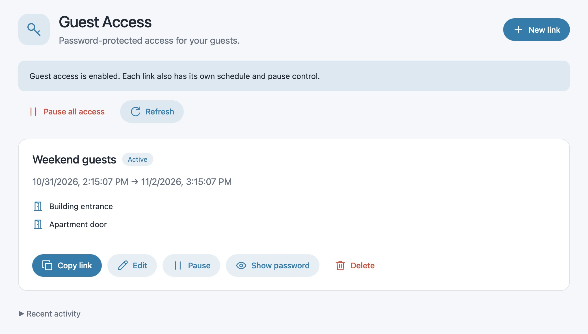
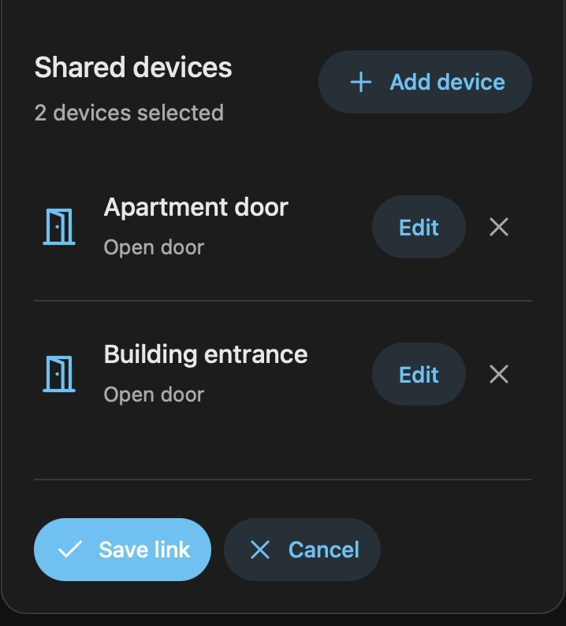
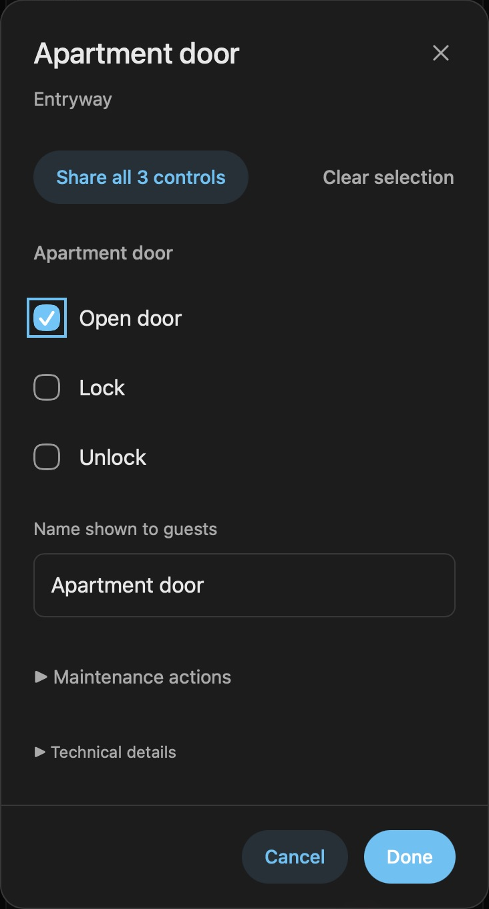
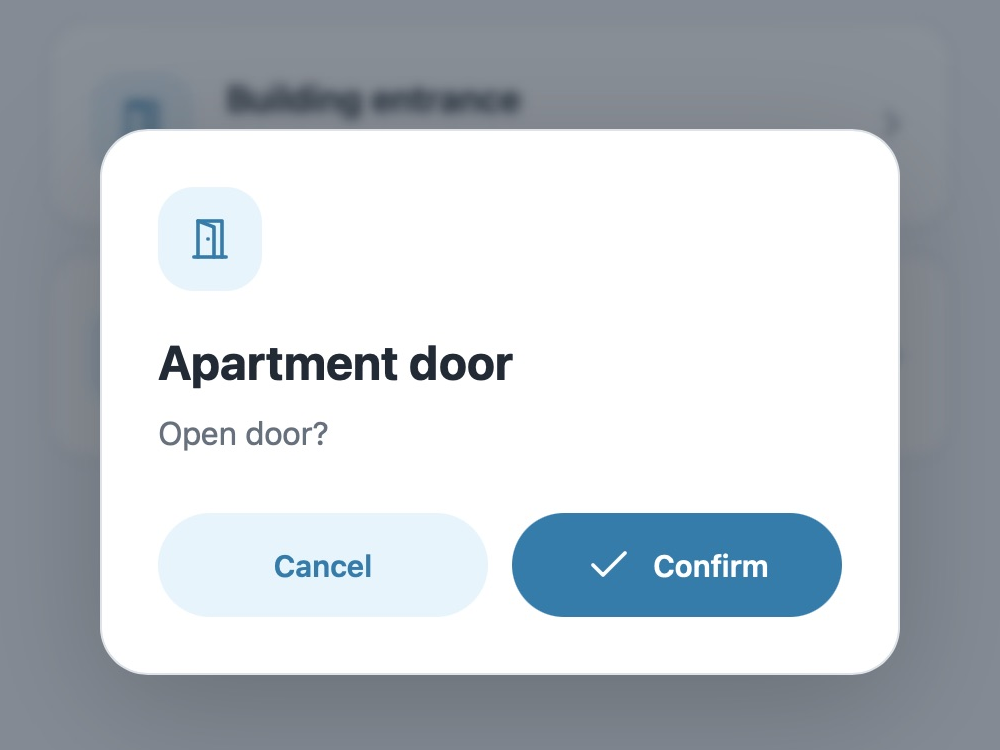
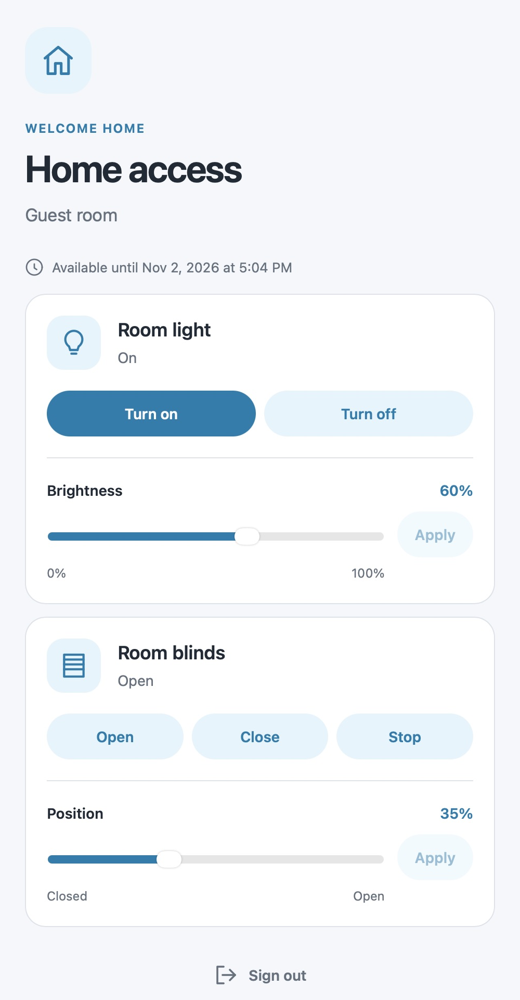

# Guest Access for Home Assistant

Give visitors a link to open a door or use a few controls in your home. Choose
what they can do and when, protect the link with a password, and pause access
whenever you need to. Your guests don't need a Home Assistant account or app.

[](https://github.com/fiam/home-assistant-guest-access/actions/workflows/checks.yml)
[](https://github.com/fiam/home-assistant-guest-access/releases/latest)
[](LICENSE)

<p align="center">
  
  
</p>

## Features

- **Share individual actions.** Let someone open a door without giving them the
  lock's other controls or access to the rest of your home.
- **Share a room's controls.** Select its lights and blinds once. Guests get one
  card per device, with brightness and position sliders where supported.
- **Prepare for a visit.** Set a start and end time, then send the link in advance.
  Change the dates, buttons, or password later without replacing the link.
- **Stay in control.** Pause one guest link or all access at once. Every button
  asks for confirmation before sending a command.
- **Sign in once.** Guests can choose to remember their browser. You can retrieve
  a forgotten password from the admin panel or change it to revoke sign-ins.
- **Make guests feel at home.** The page follows their browser's language and
  light/dark preference. English, Portuguese, and Spanish are supported.

Guest Access runs inside Home Assistant. It doesn't need a separate server,
container, or subscription.

## Installation

Requires **Home Assistant 2026.10.4 or newer**.

### 1. Install with HACS or Marketplace

[](https://my.home-assistant.io/redirect/hacs_repository/?owner=fiam&repository=home-assistant-guest-access&category=integration)

Click the button to open your Home Assistant, add this repository, and install
**Guest Access**. It is available as a custom repository; it isn't in the default
catalog yet.

| Home Assistant version | Where to find it |
| --- | --- |
| **2026.10.x** | [HACS](https://www.hacs.xyz/docs/use/). Download the integration, then restart Home Assistant. |
| **2026.11+** | **Settings → Marketplace**. Follow the installation prompts and restart if asked. |

**HACS is becoming Marketplace in Home Assistant 2026.11.** Your existing HACS
installations and custom repositories move over automatically; you don't need
to install HACS separately. The button above works with both. See the
[Home Assistant transition guide](https://contributors.home-assistant.io/marketplace/how-it-works/)
and [HACS announcement](https://www.hacs.xyz/docs/marketplace/).

*2026.11 is still in beta as of October 31, 2026. These instructions follow the
announced Marketplace transition.*

If the button doesn't work, open **Custom repositories** in HACS or Marketplace,
add the URL below, select **Integration**, and install **Guest Access**. You may
be asked to connect your GitHub account.

```text
https://github.com/fiam/home-assistant-guest-access
```

### 2. Set up Guest Access

[](https://my.home-assistant.io/redirect/config_flow_start/?domain=guest_access)

Or go to **Settings → Devices & services → Add integration → Guest Access**.
You'll find **Guest Access** in the sidebar when signed in as an administrator.
All access starts paused until you're ready to share a link.

<details>
<summary>Prefer to install manually?</summary>

Download `guest-access-<version>.zip` and its SHA-256 file from the
[latest release](https://github.com/fiam/home-assistant-guest-access/releases/latest).
Verify the checksum, then extract the ZIP into your Home Assistant configuration
directory. You should have `custom_components/guest_access/manifest.json`.
Restart Home Assistant and add the integration as described above.

</details>

## Share access



1. Open **Guest Access → New link** and give it a name, such as “Weekend guests”.
2. Set when access starts and ends. Dates use your browser's local time.
3. Select **Add device**, then choose a device. Share all its controls or select
   just the ones your guest needs, such as **Open door**. Give it a clear guest
   name and select **Done**. Repeat for any other devices.
4. Enter a password of 12–128 characters, or leave it blank to generate one.
   Use **Show password** whenever you need to see it again.
5. **Save link** and enable guest access. A future start time lets you set everything
   up before your guest arrives.
6. **Copy link** and send it to your guest. Send the password separately through
   a secure channel.

The link editor shows only the devices you have chosen. Select **Edit** beside
a device to change its controls or guest name.

<p align="center"></p>

<details>
<summary>Choose exactly what to share</summary>

<p align="center"></p>

Maintenance actions, such as Identify, stay separate from everyday controls.

</details>

Your guest opens the link, signs in, and chooses a button. They'll see a
confirmation before anything happens. On iPhone, they can use Safari's **Add to
Home Screen** to keep the link handy.

<p align="center"></p>

Lights and blinds keep their controls together. Guests can adjust a slider,
choose **Apply**, and confirm the change. Selecting a device shares its listed
controls at the time you save; it doesn't automatically add future controls.

<p align="center"></p>

The built-in names **Apartment door** and **Building entrance** follow the guest's
language. Names you write yourself stay as you entered them.

### Supported controls

| Device | Actions you can share separately |
| --- | --- |
| Lock | Open door, lock, unlock |
| Cover / blind | Open, close, stop, position |
| Button / input button | Press |
| Light | Turn on, turn off, brightness |
| Switch / fan | Turn on, turn off |

Only controls supported by the device are offered. Existing links keep their
selected actions when you edit them.

Scripts and arbitrary service calls aren't supported. If a shared button
triggers an automation, your guest can trigger that automation too.
Unavailable devices have disabled buttons. “Request sent” means Home Assistant
accepted the command; it doesn't confirm that a door physically opened.

### Change or stop access

Use **Edit** to change dates, buttons, or the password. **Pause** stops one link;
**Pause all access** stops every link. Changes apply to the next request, even
from a page that's already open. A command already sent can't be cancelled.

Pausing or changing the schedule keeps remembered browsers signed in, so guests
can return when you resume access. Changing the password or deleting the link
revokes those sign-ins. Guests can also **Sign out** to forget their browser.

## Sharing safely

Use HTTPS when sharing access outside your home. Keep the link and password
private, and send them separately. If you need to withdraw access, pause the
link or change its password.

[Security information](docs/security.md) · [Report a security issue](SECURITY.md)

## Updates and removal

Update through HACS or Marketplace and restart if prompted. To remove Guest
Access, go to **Settings → Devices & services**. This also deletes your guest links.

[Manual updates and backups](docs/maintenance.md)

## Contributing

Bug reports and improvements are welcome. See [CONTRIBUTING.md](CONTRIBUTING.md)
for development, tests, and a local demo.

[Changelog](CHANGELOG.md) · [MIT license](LICENSE)
